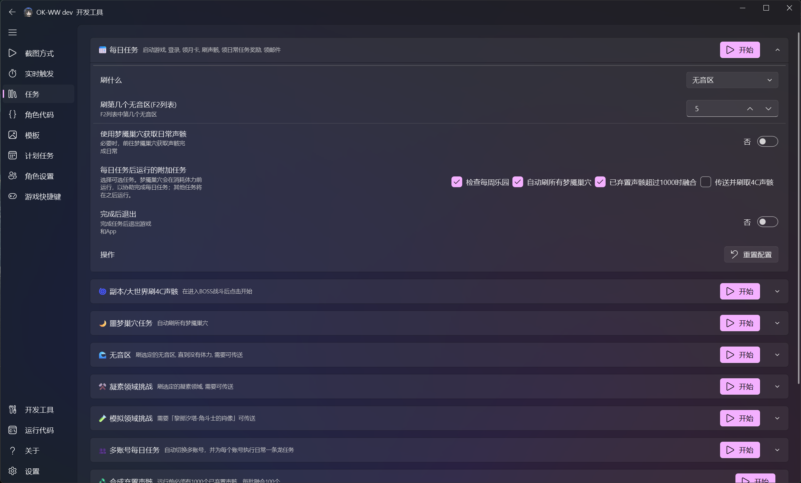
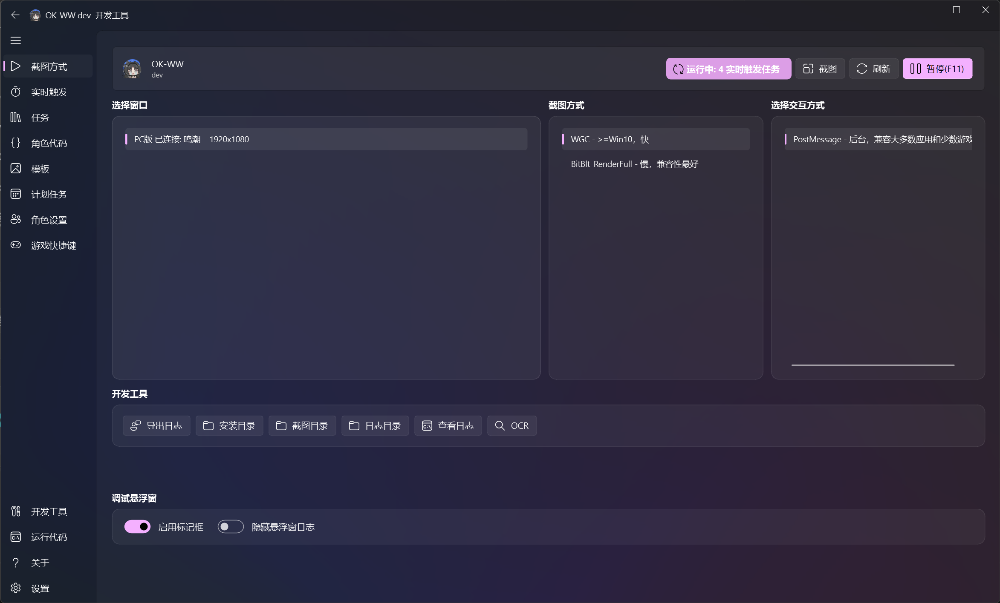
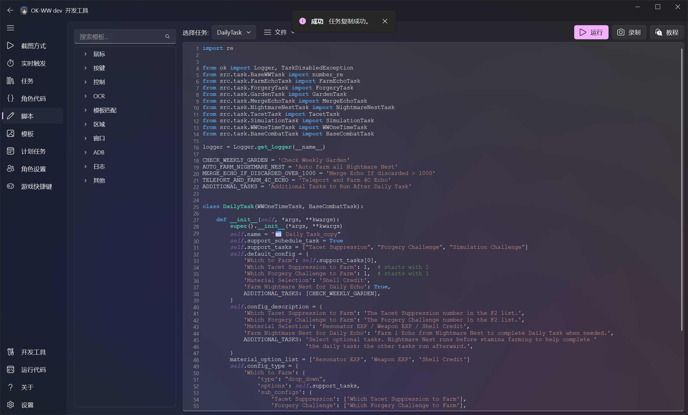
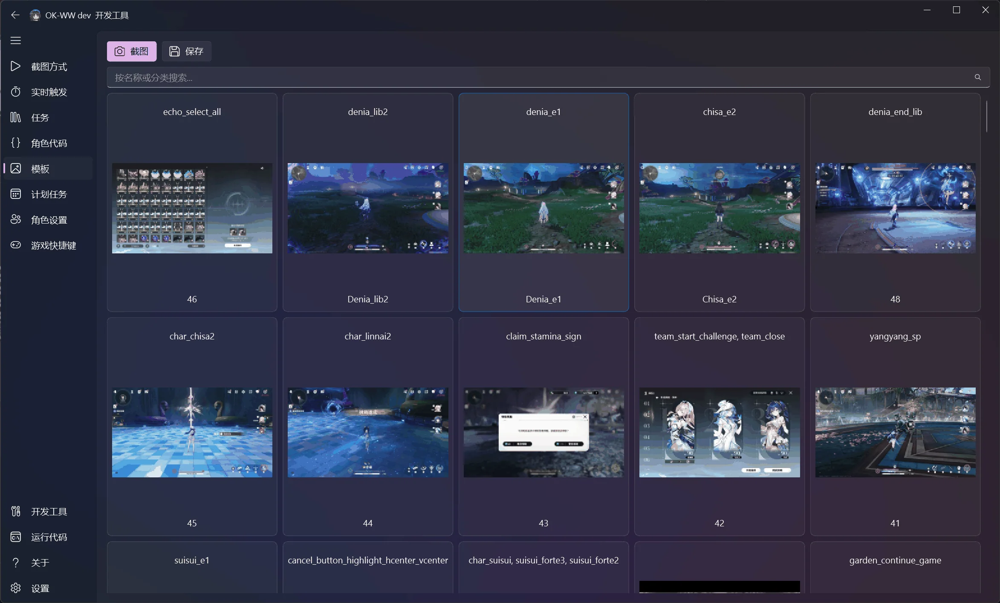

# ok-script

**简体中文** | [English](README_en.md)

**开发时用 Token，写好的 Python 自动化脚本反复用。**

把需求告诉编程代理，通过 MCP 连接 ok-script，让代理观察应用、检查已安装 API、编写并测试 Python 任务。保存成果后，从应用 GUI 或命令行重复运行，无需代理或大模型调用。

开发可能需要多轮验证，应用变化后也可能需要修复。目标是把 Token 用在脚本开发和维护上；日常执行由本地 Python 完成截图、识别和输入。

ok-script 支持 Windows 应用和游戏、安卓模拟器及 ADB 设备，提供模板匹配、OCR、目标支持时的后台输入、桌面界面和任务打包。

[MCP 快速开始](docs/quick_start/README.md) · [编程代理提示词](docs/agent-prompts.md) · [MCP 连接说明（英文）](docs/mcp.md)

## 可以这样告诉编程代理

首次安装环境：

> 在当前项目中安装 ok-script 并配置运行环境。先读取 https://raw.githubusercontent.com/ok-oldking/ok-script/master/docs/agent-setup.md ，按照其中的安装技能操作，保留项目现有的依赖约束。

[代理安装指南（英文）](docs/agent-setup.md)提供可添加到应用项目 `AGENTS.md` 的简短指令，让后续安装请求也能找到这些技能，无需先安装包或启动 MCP。

开发自动化任务：

> 连接这个项目的 ok-script MCP 服务，读取开发技能。检查已安装的截图、匹配和输入 API，给出准确签名和源码位置。开发可复用 Python 任务：打开设置、启用“显示详情”、保存并验证结果。每次尝试前恢复并验证起始界面，测试重复运行，代码保存到项目中。使用 ok-script API 和 MCP，不使用 Computer Use 工具。最后给出不依赖代理或大模型调用的准确运行命令。

## 特性

- 纯 Python 实现，免费开源，可直接使用 pip 生态中的第三方库
- 同一套任务代码可支持 Windows 客户端、安卓模拟器和 ADB 设备
- 支持 OCR、OpenCV 模板匹配以及 YOLO 等视觉方案
- 基于 COCO 标注管理模板素材，并根据屏幕分辨率自动缩放
- 内置截图、输入、设备控制和可视化调试工具
- 支持自动化测试、GitHub Actions 构建和安装包发布
- 支持多语言国际化和在线增量更新

## 通过 MCP 连接

使用自动化应用自己的虚拟环境，并保留现有依赖约束。新项目可以从[应用模板](https://github.com/ok-oldking/ok-script-app)开始，让代理配置目标。支持 Python 3.11 及以上版本。

```powershell
python -m venv .venv
.\.venv\Scripts\python.exe -m pip install "ok-script[default]"
.\.venv\Scripts\python.exe -m ok mcp --config src.config:config
```

启动命令要求应用配置已经存在，请使用实际配置入口或项目已有的开发启动器。MCP 自 2.0.17 起随 ok-script 自动安装，无需额外扩展。OpenCV 需单独选择并安装一个兼容变体；Qt、ADB 和 OCR 按需安装。

让代理的 MCP 客户端连接有效 `logs/mcp/connections/<pid>-<port>.json` 记录中的 URL，并使用该记录的 `Authorization: Bearer <token>` 请求头。不要公开凭据。让代理调用 `list_skills`，通过 `get_skill` 读取相关技能，再用 `screenshot` 验证目标。

[MCP 快速开始](docs/quick_start/README.md)介绍安装、连接以及脱离代理运行保存的任务。[MCP 说明（英文）](docs/mcp.md)包含执行和重载细节。

## 文档

- [MCP 快速开始](docs/quick_start/README.md)
- [让编程代理查询 API 和开发任务](docs/agent-prompts.md)
- [文档中心](docs/index.md)
- [维护和分享可复用任务](docs/after_quick_start/README.md)

具体 Python API 由代理检查已安装包的源码和签名。MCP 提供开发技能和执行工具，没有单独的 API 查询工具。完成的任务可在无界面模式或桌面 GUI 中运行，详见[运行时架构](docs/architecture.md)。

## 界面预览

| 任务配置 | 截图与交互 |
| --- | --- |
|  |  |

| 脚本与 API | 模板管理 |
| --- | --- |
|  |  |

[查看界面与开发工具完整说明](docs/interface.md)，包括模板识别调试浮层。

## 使用 ok-script 的项目

- [ok-script 应用模板](https://github.com/ok-oldking/ok-script-app)
- [鸣潮](https://github.com/ok-oldking/ok-wuthering-waves)
- [原神](https://github.com/ok-oldking/ok-genshin-impact)（停止维护，后台过剧情仍可用）
- [少女前线 2](https://github.com/ok-oldking/ok-gf2)
- [崩坏：星穹铁道](https://github.com/Shasnow/ok-starrailassistant)
- [星痕共鸣](https://github.com/Sanheiii/ok-star-resonance)
- [二重螺旋](https://github.com/BnanZ0/ok-duet-night-abyss)
- [卡厄思梦境](https://github.com/baoxin1100/ok-kes)
- [阴阳师](https://github.com/YunLiuZ/ok-Onmyoji)
- [白荆回廊](https://github.com/ok-oldking/ok-baijing)（停止维护）
- [明日方舟：终末地](https://github.com/AliceJump/ok-end-field)
- [异环](https://github.com/BnanZ0/ok-nte)
- [棕色尘埃 2](https://github.com/GodRaymond233/ok-bd2)
- [蓝色星原：旅谣](https://github.com/longer-sausage/OK-AzurPromilia)

## 社区与发布

- 开发者 QQ 群：938132715
- [PyPI](https://pypi.org/project/ok-script/)
- [GitHub](https://github.com/ok-oldking/ok-script)

## 致谢

ok-script 的开发离不开以下开源项目：

- [PyAppify](https://github.com/ok-oldking/pyappify)：用于应用更新和打包。
- [OnnxOCR](https://github.com/ok-oldking/OnnxOCR)：提供支持 Intel NPU 的 OCR，
  支持通过 OpenVINO 或 ONNX Runtime 推理，并使用 PaddleOCR v5 模型。
- [PySide6](https://wiki.qt.io/Qt_for_Python)：提供基于 Qt 的桌面界面绑定。
- [PyQt-Fluent-Widgets](https://github.com/zhiyiYo/PyQt-Fluent-Widgets)：Qt
  界面使用的 Fluent UI 组件。
- [OpenCV](https://opencv.org/)、[NumPy](https://numpy.org/) 和
  [Pillow](https://python-pillow.org/)：用于图像处理和计算机视觉。
- [adbutils](https://github.com/openatx/adbutils)：用于 Android 设备连接。

上述依赖均受其各自许可证约束，详情请参阅对应项目页面。

## 许可证

本项目采用 [Apache License 2.0 + Commons Clause 及附加条款](LICENSE.txt)。

允许的使用方式：

- 可用于闭源项目或商业项目。
- 可以 fork、本项目改进，并保持 fork 开源且免费。

限制：

- 禁止直接出售本项目，或仅改名、稍作修改后将其作为竞争产品出售或推广。
- 禁止将本项目用于黑客攻击、未授权访问、恶意软件、欺诈或其他违法活动。
- 任何使用 ok-script 的项目，都必须在项目网站、GitHub 或软件本身至少一处提及并链接 [ok-script.com](https://ok-script.com/) 或 [ok-script GitHub](https://github.com/ok-oldking/ok-script)。
- Qt UI 的使用还必须遵守 [PyQt-Fluent-Widgets](https://github.com/zhiyiYo/PyQt-Fluent-Widgets) 的许可证。
