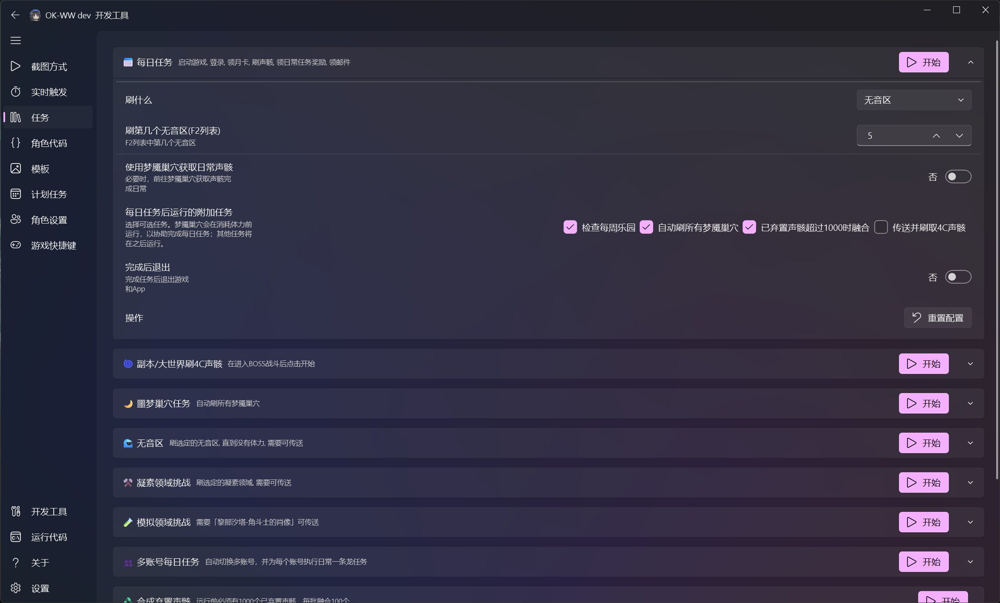
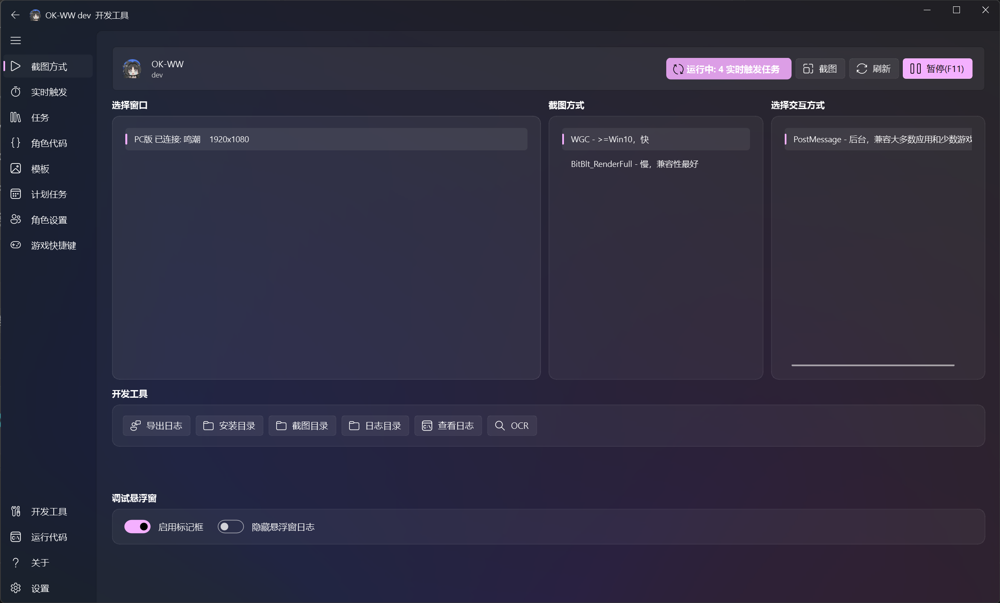
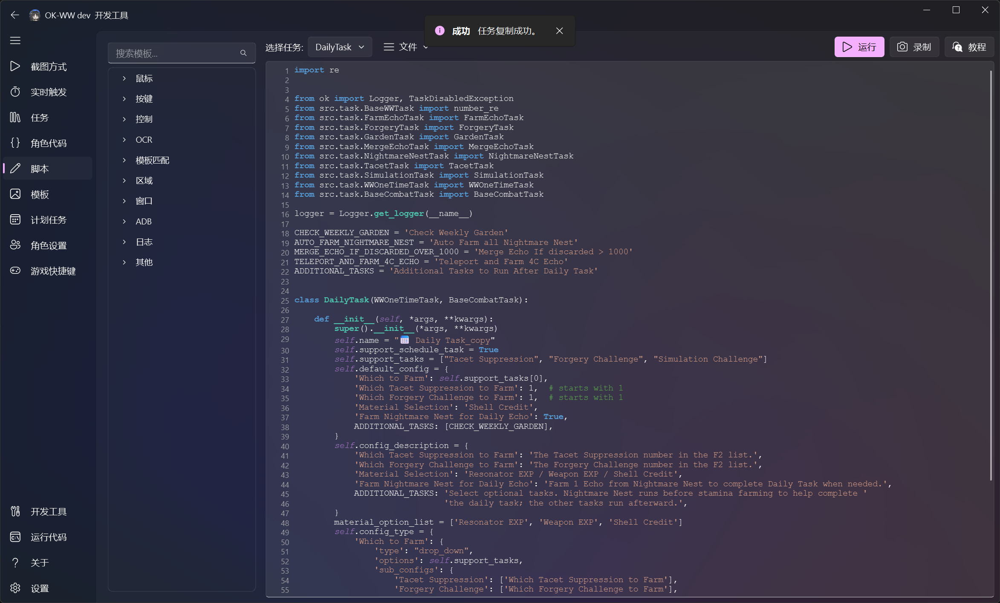
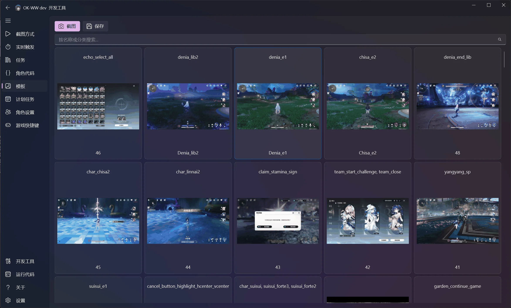

# ok-script

[简体中文](README.md) | **English**

**Vibe Coding Automation Framework**

Make a wish in Codex, Claude Code, or any coding agent with MCP, and get a deployable automation app.

Describe what you want automated. Through MCP, the agent observes your Windows application, game, or Android device, writes Python tasks, runs them against the real target, and fixes what fails. ok-script packages the finished tasks with a desktop GUI into a Windows installer you can ship. The packaged app runs on its own with local capture, recognition, and input; no agent stays connected.

ok-script supports Windows applications and games, Android emulators, and ADB devices, with template matching, OCR, background input where supported, a desktop UI, and task packaging.

[Start with MCP](docs/en/quick_start.md) · [Prompts for your coding agent](docs/en/agent-prompts.md) · [MCP connection guide](docs/mcp.md)

## Ask your coding agent

For a new environment:

> Install ok-script and set up this project's environment. First read https://raw.githubusercontent.com/ok-oldking/ok-script/master/docs/agent-setup.md and follow its setup skills. Preserve this project's existing dependency constraints.

The [agent setup guide](docs/agent-setup.md) includes a small instruction for your project's `AGENTS.md` so future setup requests use these instructions. It works before installation or MCP startup.

For task development:

> Connect to this project's ok-script MCP server and read its development skill. Inspect the installed capture, matching, and input APIs and show their exact signatures and source locations. Build a reusable Python task that opens Settings, enables "Show details", saves, and verifies the result. Restore and verify the starting screen before every attempt, test repeated runs, and save the task in the project. Use ok-script APIs and MCP, not Computer Use tools. Give me the exact command to run the finished task without an agent or LLM calls.

For repairing an existing task:

> Connect to this project's ok-script MCP server and read its reload-tasks skill. Use list_tasks to find the source of the failing task, fix that file, reload its task ID, and wait for the reload to succeed. Restore and verify the starting screen, run the registered implementation repeatedly, and show me the evidence from the run logs and screenshots.

## How MCP development works

The agent edits files and reads logs with its own tools. MCP gives it the running application:

1. **Learn** — `list_skills` and `get_skill` return the development, template, test, and reload workflows bundled with the installed ok-script version. The agent reads exact Python signatures from the installed package.
2. **Observe** — `screenshot` saves the current frame of the configured window or device.
3. **Run** — `run_task` executes a Python task file against the real target. Every attempt restores and verifies the starting state before `run()` performs and asserts the automation.
4. **Inspect** — each attempt writes `logs/mcp/<run_id>/run.log`, `status.json`, and task screenshots. `get_run_status` reports progress and errors; `stop_task` cancels.
5. **Repair** — `list_tasks` returns registered task sources; after editing, `reload_tasks` replaces them in the running process. `exit_process` ends a runtime that cannot be reset.
6. **Ship** — register the task in the project configuration, run it from the GUI or `python -m ok run_task`, and package the app as a Windows installer with [PyAppify](https://github.com/ok-oldking/pyappify).

## Features

- MCP server for coding agents: bundled skills, live capture, task execution, hot reload, and per-attempt logs
- Pure Python and open source, with access to the full pip ecosystem
- One task implementation can support Windows clients, Android emulators, and ADB devices
- OCR, OpenCV template matching, and integration with vision frameworks such as YOLO
- COCO-based template asset management with automatic resolution scaling
- Built-in capture, input, device control, and visual debugging tools
- Automated tests, GitHub Actions builds, and installer publishing
- Internationalization and online incremental updates

## Connect through MCP

Use an automation application's own virtual environment and preserve its existing requirements. For a new project, start from the [application template](https://github.com/ok-oldking/ok-script-app) and ask the agent to configure the target. Python 3.11 or later is supported.

```powershell
python -m venv .venv
.\.venv\Scripts\python.exe -m pip install "ok-script[default]"
.\.venv\Scripts\python.exe -m ok mcp --config src.config:config
```

The command assumes the application's configuration exists; use its actual import target or existing development launcher. MCP is installed automatically with ok-script starting in 2.0.17; no extra is needed. Install exactly one compatible OpenCV variant separately; add Qt, ADB, and OCR dependencies only as needed.

Connect the agent's MCP client over Streamable HTTP to the URL in the live `logs/mcp/connections/<pid>-<port>.json` record, with `Authorization: Bearer <token>` from that record. Keep credentials private. Have the agent call `list_skills`, read the relevant skills with `get_skill`, and verify the target with `screenshot`.

An existing desktop application can instead enable MCP in **Settings > Basic Options > Enable MCP Server** or start with `python -m ok gui --config src.config:config --mcp`. The server listens only on local loopback, but connected agents can run Python with your account's permissions. Keep a separate MCP-disabled launcher for everyday use.

See the [MCP quick start](docs/en/quick_start.md) for setup, connection, and running the saved task without an agent. The [MCP guide](docs/mcp.md) covers execution and reload behavior.

## Documentation

- [MCP quick start](docs/en/quick_start.md)
- [Ask an agent to discover APIs and develop a task](docs/en/agent-prompts.md)
- [Documentation home](docs/en/index.md)
- [Maintain and share reusable tasks](docs/en/advanced.md)

The coding agent discovers Python APIs from the installed package's source and signatures. MCP supplies development skills and execution tools; there is no separate API lookup tool. Finished tasks can run headlessly or in the desktop GUI. See the [runtime architecture](docs/architecture.md) for details.

## Screenshots

| Task configuration | Capture and interaction |
| --- | --- |
|  |  |

| Scripting and APIs | Template management |
| --- | --- |
|  |  |

[Read the complete interface and developer-tools guide](docs/en/interface.md), including the template-matching debug overlay.

## Projects built with ok-script

- [Wuthering Waves](https://github.com/ok-oldking/ok-wuthering-waves)
- [Neverness to Everness](https://github.com/BnanZ0/ok-nte)
- [Duet Night Abyss](https://github.com/BnanZ0/ok-duet-night-abyss)
- [Arknights: Endfield](https://github.com/AliceJump/ok-end-field)
- [Girls' Frontline 2](https://github.com/ok-oldking/ok-gf2)
- [ok-script App Template](https://github.com/ok-oldking/ok-script-app)
- [BrownDust II](https://github.com/GodRaymond233/ok-bd2)
- [Blue Protocol: Star Resonance](https://github.com/Sanheiii/ok-star-resonance)
- [Chaos Zero Nightmare](https://github.com/baoxin1100/ok-kes)
- [Azur Promilia](https://github.com/longer-sausage/OK-AzurPromilia)
- [Onmyoji](https://github.com/YunLiuZ/ok-Onmyoji)
- [Genshin Impact](https://github.com/ok-oldking/ok-genshin-impact) (unmaintained; background story automation still works)
- [Ash Echoes](https://github.com/ok-oldking/ok-baijing) (unmaintained)
- [Honkai: Star Rail](https://github.com/Shasnow/ok-starrailassistant) (unmaintained)

## Developing ok-script

To try UI changes in this repository, start the GUI from the checkout with the
demo config in [main.py](main.py):

```powershell
.\.venv\Scripts\python.exe main.py
```

It targets Notepad, so no game is needed, and registers a demo one-time task and
trigger task so the Tasks, Schedule, and Templates pages have content. Settings
and logs go to the git-ignored `configs/` and `logs/` folders. Edit the `config`
dictionary or the demo tasks in `main.py` to test other options.

## Community and releases

- Developer QQ group: 938132715
- [Discord](https://discord.gg/vVyCatEBgA)
- [PyPI](https://pypi.org/project/ok-script/)
- [GitHub](https://github.com/ok-oldking/ok-script)

## Credits

ok-script is made possible by these open-source projects:

- [PyAppify](https://github.com/ok-oldking/pyappify) — application updating
  and packaging.
- [OnnxOCR](https://github.com/ok-oldking/OnnxOCR) — OCR with Intel NPU
  support through OpenVINO or ONNX Runtime, using a PaddleOCR v5 model.
- [PySide6](https://wiki.qt.io/Qt_for_Python) — Qt-based desktop UI bindings.
- [PyQt-Fluent-Widgets](https://github.com/zhiyiYo/PyQt-Fluent-Widgets) —
  Fluent UI components used by the Qt interface.
- [OpenCV](https://opencv.org/), [NumPy](https://numpy.org/), and
  [Pillow](https://python-pillow.org/) — image processing and computer vision.
- [adbutils](https://github.com/openatx/adbutils) — Android device
  connectivity.

Each dependency remains subject to its own license. See the respective
project pages for details.

## License

This project is licensed under [Apache License 2.0 with Commons Clause and
additional terms](LICENSE.txt).

The following uses are allowed:

- Use in closed-source and commercial projects.
- Forking the project, making improvements, and keeping the fork open source
  and free.

The following restrictions apply:

- Do not take this project, rename it or make only minor changes, and sell it
  or market it as a competing product.
- Do not use it for hacking, unauthorized access, malware, fraud, or any other
  illegal activity.
- Any project using ok-script must mention it and link to [ok-script.com](https://ok-script.com/)
  or the [ok-script GitHub repository](https://github.com/ok-oldking/ok-script)
  on the project's website, GitHub repository, or in the software itself.
- Qt UI use is separately subject to the license of
  [PyQt-Fluent-Widgets](https://github.com/zhiyiYo/PyQt-Fluent-Widgets).
