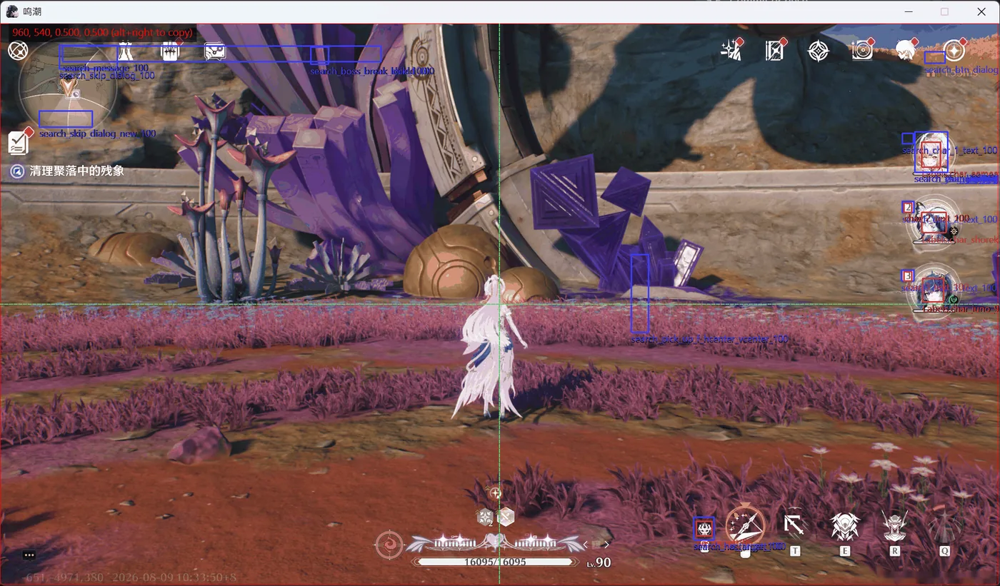

# Interface and developer tools

[简体中文](../interface.md) · [Documentation](index.md) · [Quick start](quick_start.md) · [Agent prompts](agent-prompts.md)

Use the desktop interface to configure and run saved tasks. For development, connect your coding agent through [MCP](quick_start.md) and ask it to write and test reusable Python in the project. The agent uses ok-script capture and interaction, not Computer Use tools. The interface remains useful for inspecting evidence and running the result after the agent disconnects.

ok-script brings task configuration, device connection, scripting, template management, and recognition debugging into one desktop interface. This page explains the tools shown in the current UI screenshots and how they fit together.

## Configure and run tasks

The task page lists the one-time and composite tasks supplied by an application. Expand a task card to:

- change dropdown, numeric, toggle, and multi-select options;
- read help text for each option;
- start an individual task and inspect its state;
- reset the task configuration;
- collapse tasks that do not need editing.

Application developers create these controls with `BaseTask.default_config`, `config_description`, and `config_type`. Users can adjust runtime behavior without editing Python code.

## Select capture and interaction backends

The capture page connects a target and selects the screen-capture and input backends:

1. Connect a Windows game, emulator, or ADB device under the target list.
2. Select a capture backend. WGC is generally fast, while BitBlt offers broader compatibility.
3. Select an interaction backend, such as `PostMessage` for supported background input.
4. Use the screenshot and OCR developer tools to verify the captured image.
5. Enable recognition boxes while debugging.

If capture works but input does not, check the interaction backend and administrator privileges. See the [quick-start guide](quick_start.md) for setup details.

Use ordinary `WGC` for HDR games. Only when using Windows AutoHDR (not recommended),
set `windows.capture_method` to `['WGC_HDR', 'WGC', 'BitBlt']`.
`WGC_HDR` uses `WindowsGraphicsCaptureHDRMethod` to capture floating-point HDR pixels
and convert them to SDR using BetterGI's quarter-exposure and linear-to-sRGB algorithm.
The remaining methods are fallbacks if HDR capture cannot start. Select ordinary `WGC`
for SDR content; this fixed conversion can darken SDR images and does not exactly undo
every game's HDR tone mapping. HDR conversion uses a CPU lookup table. The Auto HDR
startup alert is suppressed while `WGC_HDR` is active; it still applies after fallback.

## Browse scripts and APIs

The scripting page keeps task source and reusable API templates together:

- browse APIs by mouse, keyboard, OCR, template matching, ADB, and other categories;
- switch application tasks with the task selector;
- run or record scripts to validate a small automation sequence;
- insert common calls from templates to reduce typing errors.

The built-in editor is useful for inspection and quick experiments. Use PyCharm or VS Code with automated tests for larger changes.

## Manage template assets

The template page presents COCO source screenshots and annotation categories as cards. It supports:

- capturing new source screenshots;
- searching by name or category;
- seeing which recognition features belong to each image;
- opening the annotation tool to adjust regions;
- exporting individual feature PNGs with **Split(Recommend)**, selected by default.

The Save destinations remain `assets` and `ok_tasks/assets`; Split writes into
their `templates` subfolder. **Compress (obsolete)** is retained only for compatibility.
See the [export format](../feature-crops.md) for readable filenames and validation.

Annotate at the highest resolution you plan to support. Choose stable, distinctive regions and exclude animated text. See [Template matching with COCO assets](advanced.md#1-template-matching-with-coco-assets) for the complete workflow.

## Inspect the debug overlay

The debug overlay draws recognition state over the captured frame:

- rectangles show search regions and matches;
- labels identify features and may show thresholds or confidence values;
- center guides help verify relative coordinates and screen regions;
- overlapping results reveal templates that are too broad, thresholds that are too low, or inaccurate search regions.

The overlay is a development and diagnostic aid. Production task logic must use values returned by APIs such as `find_one`, `wait_feature`, and `ocr`, not overlay state.

## Notification settings

Notification settings live under Settings → Notification. The Windows system tray notification is enabled by default; every other channel is disabled until you turn it on. Fields for a channel only appear once the channel is enabled.

### Bark notifications

Bark delivers text notifications to the Bark app through its HTTP API, without a desktop chat client.

1. Enable **Bark Notification** (disabled by default).
2. **Bark Server URL** defaults to `https://api.day.app`. A self-hosted base URL or reverse-proxy path prefix is also supported. Do not include the device key or `/push`.
3. Enter the app's device key in **Bark Device Key**. The input field and local configuration retain the original value; do not share configuration files or logs containing the key.

Enabling Bark notifications displays the server address, device key, group, icon, sound, notification level, tap URL, and history settings at the same level.

| Setting | Default | Meaning |
| --- | --- | --- |
| Bark Group | Empty | Send without a group when empty |
| Bark Icon | Empty | Notification icon URL |
| Bark Sound | Empty | Use the Bark app's default sound, or specify a custom sound name |
| Bark Level | active | `active`, `passive`, `timeSensitive`, or `critical` (critical alert); phone permissions and system settings control actual delivery behavior |
| Bark URL | Empty | Link to open when the notification is tapped |
| Bark Archive | App Default | Follow the app, save, or do not save to history |

Delivery uses the existing background notification queue, with 2-second connection and read timeouts and no automatic retries or redirects. A Bark failure does not interrupt other providers.
Self-hosted HTTP sends the key and text without encryption; HTTPS is recommended. Screenshots are not uploaded to Bark or an image-hosting service.

Normal delivery uses the generic `NotificationManager._safe_send` path to invoke the Bark provider.
Existing task `notification()` and manager `submit()` interfaces are unchanged.

### SMTP email notifications

The SMTP channel sends email with the Python standard library `smtplib`; no extra dependency is required:

1. Turn on the **SMTP Notification** toggle to reveal the SMTP fields.
2. Fill in **SMTP Host** (server address) and **SMTP Port** (587 uses STARTTLS, 465 uses implicit SSL/SMTPS).
3. Fill in **SMTP Username** and **SMTP Password**. Prefer an app-specific password issued by your mail provider over your login password.
4. Fill in **SMTP Default Sender** (the From header address) and **SMTP Default Recipient** (separate multiple recipients with commas).
5. Turn on **SMTP Use TLS**: port 587 automatically uses STARTTLS, port 465 automatically uses implicit SSL (SMTPS).

Example server parameters:

- Gmail: `smtp.gmail.com:587`; enable two-step verification in your Google account and generate an app password.
- QQ Mail: `smtp.qq.com:587`; enable SMTP in QQ Mail settings and use the generated authorization code.

The email subject is the notification title and the body is the notification message. Screenshots attached to the notification are sent as PNG attachments; a failure to encode one attachment does not affect the others.

## Recommended workflow

1. Connect the coding agent to the project's MCP server and verify the target capture.
2. Describe the task using the [agent prompts](agent-prompts.md).
3. Have the agent discover the installed APIs, save Python code and assets, and validate through MCP.
4. Inspect logs, screenshots, and recognition overlays when diagnosing failures.
5. Run the registered task from the GUI after development, with MCP disabled.
6. Reconnect the agent for changes and add regression tests for recognition or recovery failures.
